# Pawn Studio — SA-MP / open.mp

> 🇧🇷 [Leia em português](README.pt-BR.md)

A complete Pawn environment for VS Code:

- compile from **any** file;
- syntax highlighting and IntelliSense;
- live error lens;
- a GitHub package manager with version ranges that installs plugins and includes from any repository;
- server debugging with crashdetect;
- tools: attached object editor (player and vehicle, in 3D), object finder (3D, search results and areas on the map), sprite finder, animation preview (3D), sound player, Dialog Creator and GangZone Creator.

The extension is available in **English** and **Português (Brasil)**. It follows the VS Code display
language, or you can force one with `pawnStudio.language`.

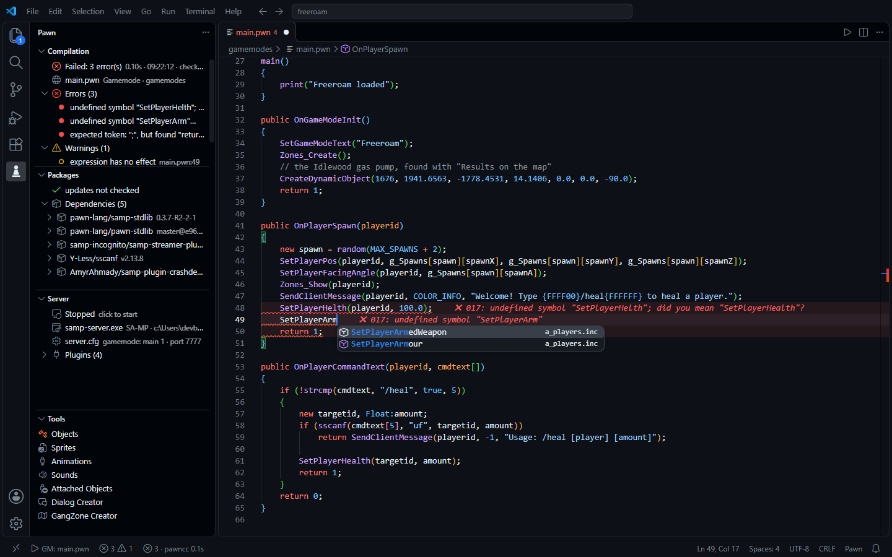

| Shortcut | What it does |
|---|---|
| **F5** / **Ctrl+Shift+B** | compiles the gamemode/filterscript that uses the open file |
| **F6** | compiles and starts the server with the debugger |
| **F12** | go to definition (including inside includes) |
| **Ctrl+Space** | autocomplete with natives, stocks, defines and enums from the whole include tree |

---

## Compile from any file

The extension reads the `#include`s of the project (ignoring commented ones) and finds out which
gamemode or filterscript uses the open file, even through several levels of modules. The status bar
shows the target (`▶ GM: main.pwn` / `▶ FS: admin.pwn`) and why it was chosen.

How the target is chosen, in order:

1. pinned target (*Pawn: Pin compile target*);
2. `// @entry ../gamemodes/main.pwn` at the top of the file;
3. the file **is** a main file;
4. the only main file that includes it (if several do, it asks once and remembers);
5. a file nobody includes yet → last target, the `pawn.json` `entry`, or the only gamemode.

A `.pwn` is a **main file** when:

- it has `main()` or `#define FILTERSCRIPT`, **or**
- it sits in `gamemodes/` or `filterscripts/` and defines `OnGameModeInit` / `OnFilterScriptInit`.

A candidate included by another main file is not a main file, so ALS hook modules are never
mistaken for gamemodes.

## "Pawn Studio" panel

Every compilation shows up in the **Pawn Studio** tab of the bottom panel (next to Problems, Output and
Terminal):

- target, time and how long it took;
- the `.amx` size, and how much it grew or shrank since the previous build;
- the memory the script needs (header, code, data and stack/heap with the estimated use), from the
  pawncc summary;
- errors and warnings: click one to go to the line;
- under **Details**: the compiler, the include folders and the command line.

The same tab also keeps the package manager log and the server log of debug sessions. The chips on top
filter by kind. `pawnStudio.revealOutput` chooses when the tab opens: on every compilation (default),
only on errors, or never.

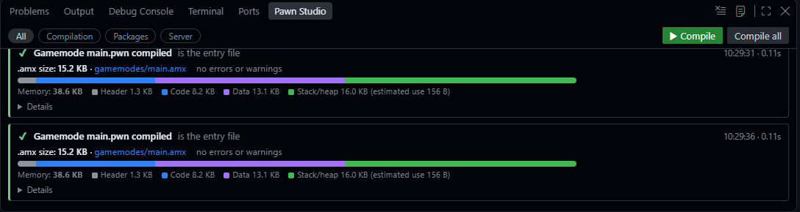

## Live error lens

Errors show up **at the end of the line** while you type, with no need to save. There are two layers:

1. **Quick analysis on every keystroke (~20 ms)**, done by the extension itself. It reports:
   - unmatched braces, parentheses and brackets;
   - unterminated strings;
   - missing `;` (when the project uses `-;+` / `#pragma semicolon 1`);
   - `#include`s that don't exist;
   - undefined functions, with a suggestion (*did you mean "SetPlayerPos"?*);
   - wrong argument counts.

   It understands multi-line strings with `\`, prefix macros (`Dialog:`, `CMD:`, `Inventory:` → `IV_`),
   y_timers, `inline` and `static` functions.
2. **`pawncc` in the background, without saving:**
   - compiles a temporary copy of the project that includes your unsaved text;
   - in large YSI gamemodes this takes as long as `pawncc` itself does, and the status bar shows
     `pawncc 12s` while it runs;
   - it isn't cancelled on every keystroke: it queues, and the results are adjusted to the edits you
     made while it was compiling.

Diagnostics **follow the text**: inserting lines moves them, and editing a line with an error clears
it right away.

## Syntax and IntelliSense

- **Full grammar:** tags (`Float:`), format specifiers (`%d`, `%s`, `{FF0000}`), packed strings,
  `#define` with `%0`, YSI keywords (`hook`, `foreach`, `inline`, `timer`) and `CMD:`.
- **Autocomplete** from the target's include tree, including file names inside `#include <`.
- **Parameters filled in:** accepting a function with Tab/Enter inserts its required parameters as
  fields, and **Tab** jumps between them:
  - `SetPlayerPos(playerid, x, y, z)`;
  - `GetPlayerName(playerid, name)` (the `len = sizeof name` parameter has a default and is left out).

  Setting: `pawnStudio.completion.parameters`.
- **Parameter hints**, **hover** with docs (the stdlib XML comments are rendered), **F12**, **outline**
  and workspace symbol search.
- **54 snippets:** SA-MP callbacks, dialogs, timers, commands, enums, `foreach`, hooks…

## Package manager (GitHub)

It works like npm, with its own `pawn.json` format, and installs **any** GitHub repository.

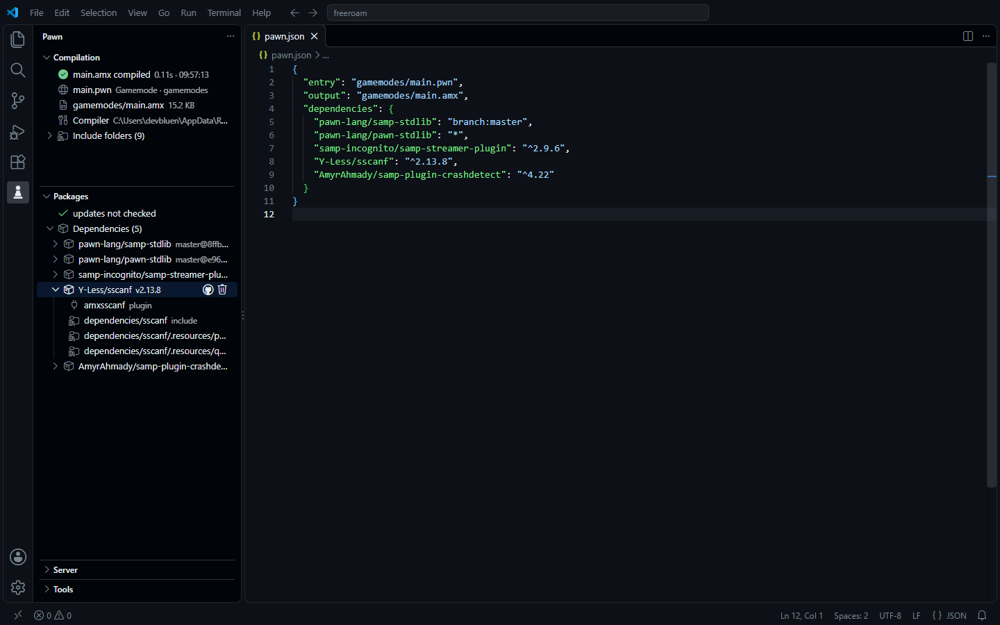

A package doesn't need to have been written for Pawn Studio. When a repository has no `pawn.json`,
the extension works out on its own:

- where the `.inc` files are (`include/`, `pawno/include`, or the repository root);
- which file in the **release** holds the plugin for your system:
  - Windows: `-win32.zip`, `.dll`;
  - Linux: `-linux.tar.gz`, `.so`;
  - 32-bit builds are preferred over 64-bit;
- what each file inside the archive is:
  - **plugins** (`plugins/`) are copied to `plugins/` and registered in the server configuration;
  - **open.mp components** (`components/`) are copied to `components/`;
  - **libraries** the plugin needs (for example `libmariadb.dll` and `log-core.dll` from MySQL)
    go next to the server executable.

### Search and install

In the Pawn sidebar, open **Packages** and click `+`:

- the search goes straight to GitHub (repositories with the `pawn-package` topic, plus SA-MP
  repositories);
- you pick the version:
  - `^2.9.6` (recommended): receives compatible updates;
  - an exact version;
  - a branch.

### When a package is installed

- the code goes to `.pawn-studio/dependencies/`;
- plugins, components and libraries go to the server, as described above;
- plugins are registered in `server.cfg` (SA-MP) or `config.json` (open.mp);
- the include folders go to the compiler and to IntelliSense, with no configuration;
- packages that the package itself lists in its `pawn.json` are installed too. If your project asks
  for a different version of the same package, your version wins.

### Updates

The view shows each package in one of these states:

- **✓**: up to date.
- **`v2.9.4 → v2.9.6`**: a newer version fits the range in `pawn.json`. Updating it is safe.
- **`v2.9.6 · v3.0.0 available`**: a new **major** version exists outside the range. Updating
  asks for confirmation, because it may break your code, and then changes `pawn.json` to `^3.0.0`.
- **not installed**: the package is in `pawn.json` but missing from `.pawn-studio/dependencies/`.

### Lock file and removal

- **`pawn-lock.json`:** records the exact tag and commit of each package. Anyone who clones the
  project gets exactly the same code with **Install pawn.json dependencies**.
- **Remove:** deletes the files, plugins and libraries, removes the plugin from `server.cfg`, and
  cleans up dependencies that nothing uses anymore.

### GitHub limits

Without signing in, GitHub allows 60 requests per hour and 10 searches per minute.
*Pawn: Sign in to GitHub* uses the account already connected to VS Code and raises the limit to 5000
per hour.

---

## Creating `pawn.json`

`pawn.json` lives in the **server root** (the folder that contains `gamemodes/`). It tells the
extension:

- which file is the gamemode;
- where to write the `.amx`;
- which packages the project uses, and in which versions.

### Option 1 — with the command (recommended)

1. Open the server folder in VS Code.
2. Run **Pawn: Create pawn.json** from the Command Palette (`Ctrl+Shift+P`), or click **Create pawn.json**
   in the *Packages* view.
3. The file is created with the detected gamemode:

```json
{
	"name": "my-server",
	"version": "1.0.0",
	"entry": "gamemodes/main.pwn",
	"output": "gamemodes/main.amx",
	"dependencies": {}
}
```

You don't have to write the dependencies by hand. When you install a package with **Install
package...**, the extension adds it to `dependencies` with the chosen version.

### Option 2 — by hand

Create a `pawn.json` file in the server root. The editor validates it and autocompletes the fields
as you type.

```json
{
	"name": "my-server",
	"version": "1.0.0",
	"entry": "gamemodes/main.pwn",
	"output": "gamemodes/main.amx",
	"dependencies": {
		"samp-incognito/samp-streamer-plugin": "^2.9.6",
		"pBlueG/SA-MP-MySQL": "^R41-4",
		"pawn-lang/YSI-Includes": "branch:5.x"
	},
	"devDependencies": {
		"AmyrAhmady/samp-plugin-crashdetect": "^4.22"
	}
}
```

Then run **Pawn: Install pawn.json dependencies** (or the ☁ button in the *Packages* view).

### Fields

| Field | Required | Description |
|---|---|---|
| `name` | no | name of the project |
| `version` | no | version of the project (for your own reference) |
| `entry` | recommended | main `.pwn` file, relative to `pawn.json` |
| `output` | no | `.amx` to generate (default: next to the `.pwn`) |
| `dependencies` | no | `{ "user/repo": "version" }`: GitHub packages (see the versions below) |
| `devDependencies` | no | same format; packages only needed during development (e.g. crashdetect) |
| `target` | no | which builds packages install (server, system, arch, variant), see [Project settings](#project-settings-target-and-compiler) |
| `compiler` | no | pawncc `path`, `args` and `includes` of this project |
| `supports` | packages only | servers the package is for: `samp`, `openmp` or both |
| `include` | packages only | folder(s) with the `.inc` files you export (optionally per server) |
| `plugins` | packages only | which release file holds the binaries, per system / arch / variant |
| `components` | packages only | the open.mp component file, when it is separate from `plugins` |

### Versions

The key is the GitHub repository (`user/repo`). The value says which version to install.

| Value | Installs |
|---|---|
| `"^2.9.6"` | the newest **2.x.x** version that is at least 2.9.6 (default when installing) |
| `"~2.9.6"` | the newest **2.9.x** version (fixes only) |
| `"2.9.6"` | exactly 2.9.6 (the tag `v2.9.6` or `2.9.6`) |
| `"2.x"`, `">=1.2 <2"`, `"^1 \|\| ^2"` | any version in the range |
| `"latest"` | the newest version (or the default branch if the repository has no tags) |
| `"tag:r1-final"` | a tag by its exact name, for tags that aren't version numbers |
| `"branch:dev"` | the newest commit of the branch (the commit is locked in `pawn-lock.json`) |
| `"commit:a1b2c3d"` | exactly that commit |

Tags in the `v1.2.3` and `1.2.3` styles work, and so does the SA-MP style `R41-4`, which is read
as `41.4`. Pre-releases (`-beta`, `-rc1`) are only installed when the version you ask for names one.

### What to commit

- ✅ `pawn.json` and `pawn-lock.json`: anyone who clones the project gets the same versions with
  *Install pawn.json dependencies*.
- ❌ `.pawn-studio/`: the downloaded packages. It is downloaded again from the lock, and it has its own
  `.gitignore`, so git skips it without you doing anything. (Projects from versions before 1.4 had a
  `dependencies/` folder: the packages move to `.pawn-studio/dependencies/` on their own.)

### Publishing your own package

Find your case below, copy its `pawn.json` to the root of your repository and name the release files
the same way. Then:

1. commit the `pawn.json` **before** creating the tag: installers read the `pawn.json` inside the tag
   (`v1.0.0`), not the one on your main branch;
2. create the GitHub release for that tag and attach the files;
3. run **Pawn: Check my package** (Packages view → ⋯): it lists what SA-MP and open.mp get on each
   system, and warns about anything missing;
4. add the **`pawn-package`** topic to the repository, so it shows up in the search.

| Your package | Case |
|---|---|
| only `.inc` files | [A](#a-include-only) |
| a SA-MP plugin (open.mp also loads it) | [B](#b-sa-mp-plugin) |
| an open.mp component only | [C](#c-openmp-component-only) |
| a plugin **and** a component, in the same file | [D](#d-plugin-and-component-in-the-same-file) |
| a plugin **and** a component, in separate files | [E](#e-plugin-and-component-in-separate-files) |
| one folder per server inside the archive (`samp/…`, `open.mp/…`) | [D2](#d2-one-folder-per-server-inside-the-archive) |
| any other organization inside the archive | [G](#g-declare-where-each-file-is-layout) |
| builds for several systems / 64-bit / dynamic | [F](#f-several-systems-architectures-and-variants) |

#### A. Include only

No `pawn.json` and no release needed: push the repository and create version tags. The `.inc` files are
found on their own (an `include/` folder, or the repository root). Add a `pawn.json` only to list
dependencies:

```json
{ "dependencies": { "pawn-lang/samp-stdlib": "latest" } }
```

#### B. SA-MP plugin

Release files:

```text
myplugin-1.0.0-win32.zip          myplugin-1.0.0-linux.tar.gz
├─ plugins/myplugin.dll           ├─ plugins/myplugin.so
└─ include/myplugin.inc           └─ include/myplugin.inc
```

```json
{
	"supports": "samp",
	"plugins": {
		"windows": "myplugin-*-win32.zip",
		"linux": "myplugin-*-linux.tar.gz"
	}
}
```

| Server | Gets |
|---|---|
| SA-MP | `plugins/myplugin.dll` + `plugins myplugin` in `server.cfg` |
| open.mp | the same file as a legacy plugin, in `pawn.legacy_plugins` of `config.json` |

#### C. open.mp component only

```text
mycomponent-1.0.0-win32.zip       mycomponent-1.0.0-linux.tar.gz
├─ components/mycomponent.dll     ├─ components/mycomponent.so
└─ include/mycomponent.inc        └─ include/mycomponent.inc
```

```json
{
	"supports": "openmp",
	"plugins": {
		"windows": "mycomponent-*-win32.zip",
		"linux": "mycomponent-*-linux.tar.gz"
	}
}
```

| Server | Gets |
|---|---|
| open.mp | `components/mycomponent.dll` (components load on their own, no config) |
| SA-MP | nothing: the install log says the package is for open.mp only |

With `"supports": "openmp"`, loose `.dll`/`.so` files at the root of the archive also count as components.

#### D. Plugin and component in the same file

One file per system, with both builds inside:

```text
audio-cast-1.0.3-windows-x86.zip
├─ plugins/audio-cast.dll         ← SA-MP
├─ components/audio-cast.dll      ← open.mp
└─ include/audio-cast.inc
```

```json
{
	"supports": ["samp", "openmp"],
	"plugins": {
		"windows": "audio-cast-*-windows-x86.zip",
		"linux": "audio-cast-*-linux-x86.zip"
	}
}
```

| Server | Gets |
|---|---|
| SA-MP | `plugins/audio-cast.dll` + `server.cfg` (the component is skipped) |
| open.mp | `components/audio-cast.dll` (the plugin is skipped, so it never loads twice) |

#### D2. One folder per server inside the archive

Each server's files in a folder of its own, as they would be laid out in that server:

```text
PawnJson-1.0.0-windows-x86.zip
├─ samp/
│  ├─ plugins/PawnJson.dll
│  └─ pawno/include/PawnJson.inc
└─ open.mp/
   ├─ components/PawnJson.dll
   └─ qawno/include/PawnJson.inc
```

```json
{
	"supports": ["samp", "openmp"],
	"plugins": {
		"windows": "PawnJson-*-windows-x86.zip",
		"linux": "PawnJson-*-linux-x86.zip"
	}
}
```

SA-MP uses only the `samp/` folder (plugin, `server.cfg` and its include); open.mp uses only `open.mp/`
(component and its include). Folder names recognized: `samp`, `sa-mp`, `legacy` and `open.mp`,
`openmp`, `omp`, at the root of the archive or one level down. With other folder names, declare them
with [`layout`](#g-declare-where-each-file-is-layout).

#### G. Declare where each file is: `layout`

When the archive is organized your own way, say where each kind of file is, per server. Paths are
relative to the archive root (a single top folder such as `mylib-1.0/` is looked through):

```text
mylib-1.0.0-win32.zip
└─ mylib-1.0.0/
   ├─ bin/legacy/mylib.dll
   ├─ bin/omp/mylib.dll
   ├─ inc/samp/mylib.inc
   ├─ inc/omp/mylib.inc
   └─ libs/libcurl.dll
```

```json
{
	"supports": ["samp", "openmp"],
	"plugins": { "windows": "mylib-*-win32.zip", "linux": "mylib-*-linux.tar.gz" },
	"layout": {
		"samp":   { "plugins": "bin/legacy", "include": "inc/samp" },
		"openmp": { "components": "bin/omp/mylib.dll", "include": "inc/omp" },
		"all":    { "libraries": "libs/*.dll" }
	}
}
```

| Role | Goes to |
|---|---|
| `plugins` | `plugins/` of the server, added to `server.cfg` / `config.json` |
| `components` | `components/` |
| `libraries` | next to the server executable |
| `include` | the include path |

- Each value is a folder (`"bin/legacy"`), a pattern (`"bin/omp/*.dll"`) or a list of them.
- `samp` is used on SA-MP servers, `openmp` on open.mp servers, `all` on both.
- Only the `.dll` (Windows) or `.so` (Linux) of the system being installed are taken from those folders.
- With `layout`, **only what it lists is installed**: no detection. A path that is not in the archive is
  reported in the install log and by **Pawn: Check my package**.

#### E. Plugin and component in separate files

```text
myplugin-1.0.0-win32.zip          myplugin-omp-1.0.0-win32.zip
└─ plugins/myplugin.dll           └─ components/myplugin.dll
```

```json
{
	"supports": ["samp", "openmp"],
	"plugins":    { "windows": "myplugin-*-win32.zip",     "linux": "myplugin-*-linux.tar.gz" },
	"components": { "windows": "myplugin-omp-*-win32.zip", "linux": "myplugin-omp-*-linux.tar.gz" }
}
```

SA-MP downloads only the `plugins` file; open.mp downloads only the `components` file. A file that a
`components` pattern matches is never used as the plugin, even when the `plugins` pattern matches it too.

#### F. Several systems, architectures and variants

Add one key per build. The plain `windows` / `linux` keys are the 32-bit builds, which is what SA-MP
and open.mp load:

```json
{
	"plugins": {
		"windows":       "mylib-*-win32.zip",
		"windows-x64":   "mylib-*-win64.zip",
		"linux":         "mylib-*-linux-static.tar.gz",
		"linux-dynamic": "mylib-*-linux-dynssl.tar.gz"
	}
}
```

The project that installs the package chooses the build with `"target"` in its own `pawn.json` (see
[Project settings](#project-settings-target-and-compiler)): `{ "os": "linux", "variant": "dynamic" }`.
A variant the package does not have falls back to the plain key of that system.

#### Reference

| Field | Values |
|---|---|
| `supports` | `"samp"`, `"openmp"` or `["samp", "openmp"]` (default) |
| `plugins` | `{ key: "file pattern" }` — the file with the binaries (`*` = anything); `false` = no binaries; left out = chosen by the file names |
| `components` | same format; only when the open.mp component is a separate file |
| `include` | `"include"`, `["a", "b"]` or `{ "samp": "...", "openmp": "...", "all": "..." }`; left out = detected |
| `layout` | where each kind of file is inside the archive, per server — see [G](#g-declare-where-each-file-is-layout) |
| `dependencies` | packages yours needs, installed together with it. The sampctl list form (`["user/repo", "user/repo:tag"]`) works too |

Keys of `plugins` / `components`: `windows`, `linux`, `windows-x64`, `linux-x64`, and variants such as
`linux-dynamic`, `linux-static` or `linux-x86-dynamic`. A value can also be a list of patterns.

Inside the release file:

| Path | Goes to |
|---|---|
| `plugins/*.dll` / `plugins/*.so` | `plugins/` of the server, added to `server.cfg` / `config.json` |
| `components/*.dll` / `components/*.so` | `components/` (open.mp only) |
| other `.dll` / `.so` (with a `plugins/` folder present) | next to the server executable (runtime libraries such as `libmariadb.dll`) |
| folders with `.inc` files | the include path, before the repository source |
| `samp/…` and `open.mp/…` (one folder per server) | only the folder of the project's server is used |

A `pawn.json` that already has sampctl fields (`user`, `repo`, `include_path`, `resources`) can keep them:
add the Pawn Studio fields next to them and the same file serves both tools. Archives inside the
release archive (a `.tar.gz` inside a `.zip`) are opened too.

When the release brings the `.inc` files, the repository source (SDKs, C++ code) is not kept in the
installer's `.pawn-studio/dependencies/` folder.

### Project settings: `target` and `compiler`

The `pawn.json` of your project (in the server folder) can hold settings that belong to the project,
so everyone who opens it gets the same:

```json
{
	"entry": "gamemodes/main.pwn",
	"target": { "os": ["windows", "linux"] },
	"compiler": {
		"path": "pawno/pawncc.exe",
		"args": ["-d3", "-;+", "-(+"],
		"includes": ["pawno/include"]
	}
}
```

**`target`** — which builds packages install:

| Key | Default | Example |
|---|---|---|
| `os` | the system of the server in the folder (or this machine) | `["windows", "linux"]`: test on Windows, host on Linux — both the `.dll` and the `.so` go to `plugins/` |
| `server` | detected from `samp-server` / `omp-server` | `"openmp"` |
| `arch` | `"x86"` (what SA-MP and open.mp load) | `"x64"` |
| `variant` | the default build | `"dynamic"`, `"static"` |

With several systems, the config file (`server.cfg` / `config.json`) is written for the server in
the folder. A SA-MP server on Linux needs the `.so` in the name (`plugins streamer.so`): the install log
shows that line for the other system.

**`compiler`** — `path` of pawncc, `args` and extra `includes` (paths relative to `pawn.json`). They win
over the `pawnStudio.compilerPath`, `pawnStudio.args` and `pawnStudio.includePaths` settings.

---

## Tools: objects, sprites, animations, sounds and dialogs

The **Tools** section of the Pawn sidebar opens seven tools. Every one inserts code at the cursor of
the file you were editing.

The finders read models, textures, animations and sounds straight from **your own GTA San Andreas
installation**: nothing from the game is bundled with the extension. The game folder is detected on
its own (SA-MP's registry key, then common install folders). If it isn't found, pick it with
**Pawn: Select the GTA San Andreas folder** or the `pawnStudio.gtaPath` setting. To use another
copy of the game later, click **Change folder** at the top right of the finders, or the
**GTA San Andreas** item at the end of the Tools section (it shows the folder in use).

| Tool | What it does | Inserts |
|---|---|---|
| **Objects** | all objects from GTA and SA-MP (`SAMP.ide`), searchable by ID, model or texture, with a 3D textured preview. Filters for source, type (static, timed, animated), map usage, LODs and draw distance. Each object shows every spot where the game places it on the map. **Results on the map**: search a name (`pump`, `atm`…) and see where every object found is, with its real position and rotation. **Map area**: drag a rectangle on the San Andreas map to list every object inside it | `CreateObject`, `CreateDynamicObject`, `RemoveBuildingForPlayer` (one object, every copy of a model, or a whole area), `SetPlayerPos`, and every position of a model as a Pawn array |
| **Sprites** | every TextDraw sprite in `models/txd` (`ld_beat:chit`, `ld_tatt:9crown`…), shown as images, with their size | a global or player TextDraw already set to the sprite font and size |
| **Animations** | every animation library (`PED`, `DANCING`, `BAR`…), played in 3D on any skin, with loop, "in place" and speed controls | `ApplyAnimation(playerid, "LIB", "NAME", …)` |
| **Sounds** | every sound ID with the game's own name (`1139 · SOUND_CHECKPOINT_RED`). The 🔊 ones **play in the editor** with the same bank sounds the game uses. The "All game sounds" view lets you listen to the ~62,000 sounds in `audio/SFX` and save any of them as `.wav` | `PlayerPlaySound(…)` with the name as a comment |
| **Attached Objects** | 3D editor to position objects on the player (any skin, 18 bones, offset, rotation, scale and material colors) or on a vehicle (any vehicle and color). Move, rotate and scale with the mouse; object browser with thumbnails (hats, helmets, glasses, masks…) | `SetPlayerAttachedObject`, or `CreateObject` + `AttachObjectToVehicle` (`CreateDynamicObject` + `AttachDynamicObjectToVehicle` with the streamer) |
| **GangZone Creator** | draws gang zones on the San Andreas map: rectangles, circles and polygons (point by point). Move and resize them with the mouse, set the color and opacity, or type the coordinates | `GangZoneCreate` + `GangZoneShowForPlayer`/`ForAll`, and with the streamer `CreateDynamicRectangle` / `CreateDynamicCircle` / `CreateDynamicPolygon` with `OnPlayerEnterDynamicArea` |
| **Dialog Creator** | builds a dialog visually, in every style, with a preview that looks like the game, `{RRGGBB}` colors and the response handler | `ShowPlayerDialog` + `OnDialogResponse`, or easyDialog `Dialog_Show` + `Dialog:name` |

**Results on the map:** every place where the objects you searched for are, with the real position and rotation.

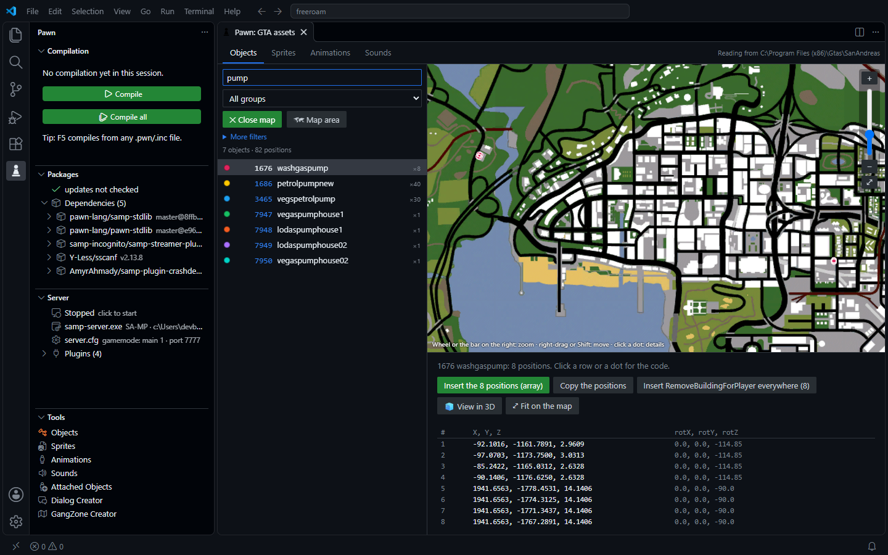

**Object preview** with the game's own textures:

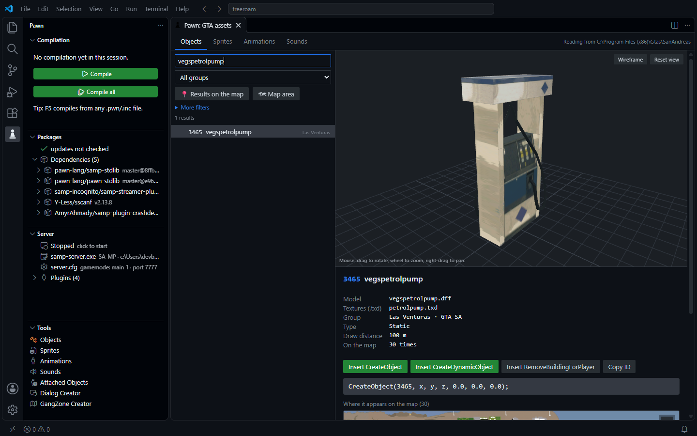

**Attached Objects:** position objects on the player or on a vehicle in 3D.

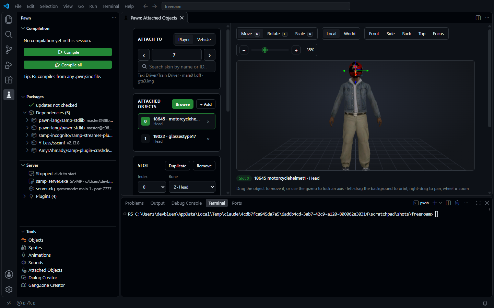

**GangZone Creator:** rectangles, circles and polygons, with streamer areas.

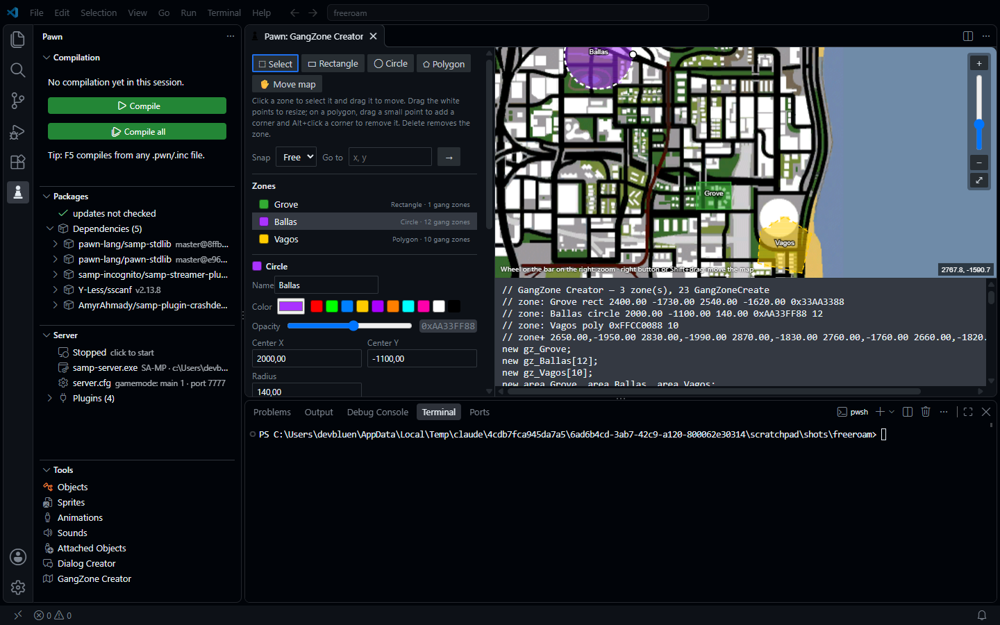

**Dialog Creator:** a preview that looks like the game.

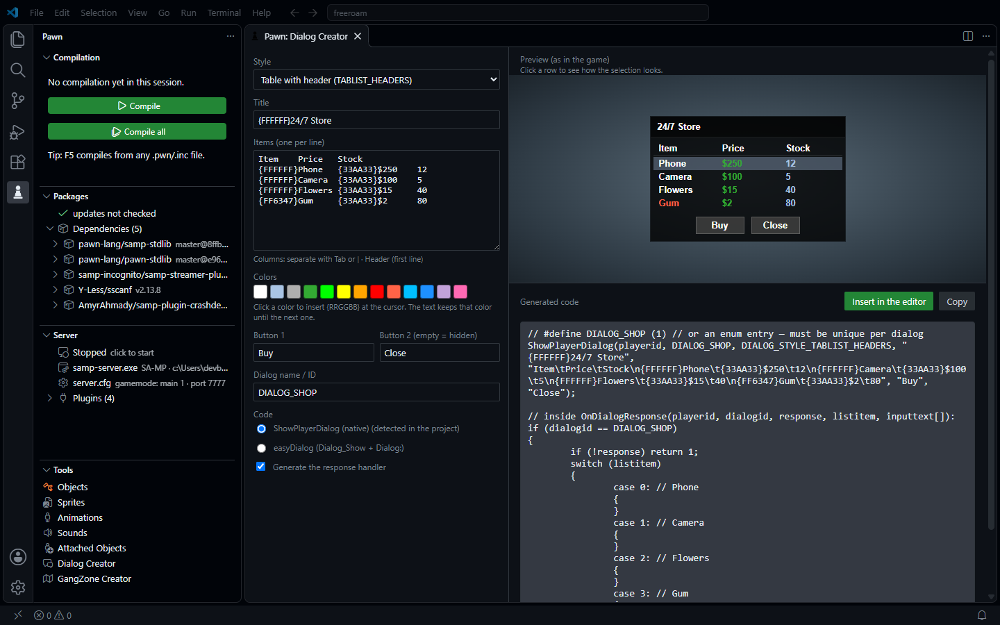

**Animations** in 3D on any skin, and **sounds** that play in the editor:

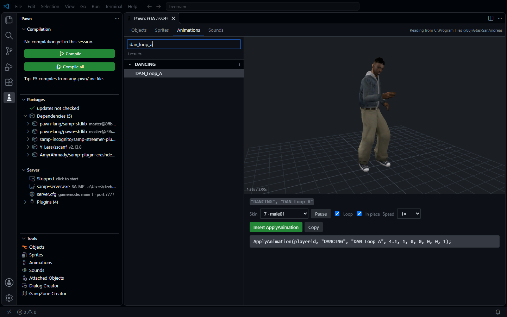

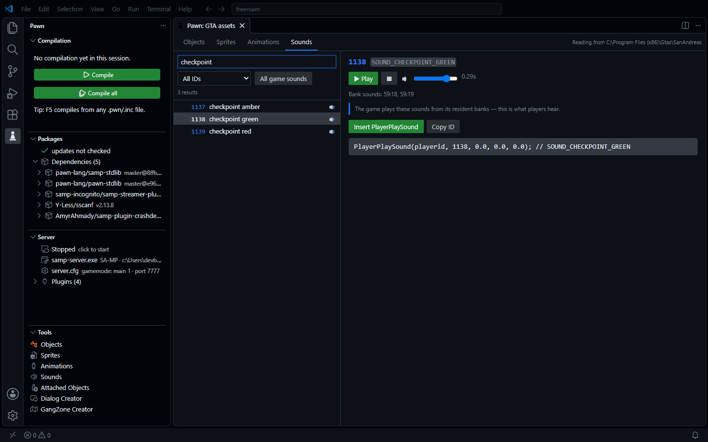

- **Dialog Creator details:**
  - With the cursor on an existing `ShowPlayerDialog` or `Dialog_Show`, the creator opens filled in
    with that dialog. It's also in the editor's right-click menu.
  - The code style follows your project: easyDialog when it already uses `Dialog_Show`.
  - Long texts are built with `strcat`, so no line goes over the compiler's limit.
- **Dialog text:** type `\t` and `\n` like in Pawn, or press Tab in the text box. Both become columns
  in `TABLIST` dialogs. SA-MP shows at most 4 columns (3 tabs per row): the Dialog Creator warns about
  longer rows and leaves the extra columns out of the code.
- **Attached Objects:** the editor comes from
  [SA-MP Preview Studio](https://github.com/devbluen/samp-preview-studio), with the models read from
  your game. With the cursor on `SetPlayerAttachedObject` or `AttachObjectToVehicle` lines (or with them
  selected), run **Pawn: Attached Objects** or use the right-click menu: they open in the editor, and
  **Insert all in the editor** writes the result back. Shortcuts: W move, E rotate, R scale, F focus.
- **Which sounds play:** the link between a sound ID and the audio banks is built into `gta_sa.exe`.
  The extension ships that table, rebuilt from the reverse-engineered game code
  ([gta-reversed](https://github.com/gta-reversed/gta-reversed)). Each ID is marked:
  - 🔊 the game plays it from its resident banks, so it is what players hear;
  - 🔇 it needs a mission audio bank that a game script loads, so it is usually silent on SA-MP;
  - 🎵 it starts a streamed music track;
  - no mark: nothing audible.
- **Map area:** the map is the game's own radar image. Placements come from the game's IPL files
  (text IPLs plus the binary stream IPLs inside `gta3.img`). The generated `RemoveBuildingForPlayer`
  lines include the LOD models, so buildings don't stay visible from far away.
- **Results on the map:** click **Results on the map** under the search box. Every object the search and
  filters find shows up on the map, one color per model. Click a model in the list to see only its
  positions (as a table), or click a dot to get its coordinates, `CreateObject` with the same rotation,
  `RemoveBuildingForPlayer` and `SetPlayerPos`. **Insert the positions** writes all of them as a Pawn
  array, handy to build a system around the game's own gas pumps, ATMs or doors. The rotation is
  converted from the IPL quaternion to the `rotX, rotY, rotZ` that `CreateObject` uses.
- **Map zoom:** every map has a zoom bar on the right (+, slider, −, whole map), so the mouse wheel
  is not needed. Double-click also zooms in.
- **GangZone Creator:** SA-MP only draws rectangular gang zones, so circles and polygons become
  horizontal strips that do not overlap (choose how many; the total is checked against the
  1024 gang zone limit). The streamer areas follow the exact shape. The generated code has
  `Zones_Create()`, `Zones_Show(playerid)` and `Zones_Hide(playerid)` (or the `ForAll` versions).
  With the cursor on `GangZoneCreate` or `CreateDynamic*` lines, run **Pawn: GangZone Creator** or use
  the right-click menu to open them in the editor; the code it generates opens again with the same shapes.
  Shortcuts: V select, R rectangle, C circle, P polygon, H move the map, Delete removes, Ctrl+D duplicates.

---

## Debugging the server

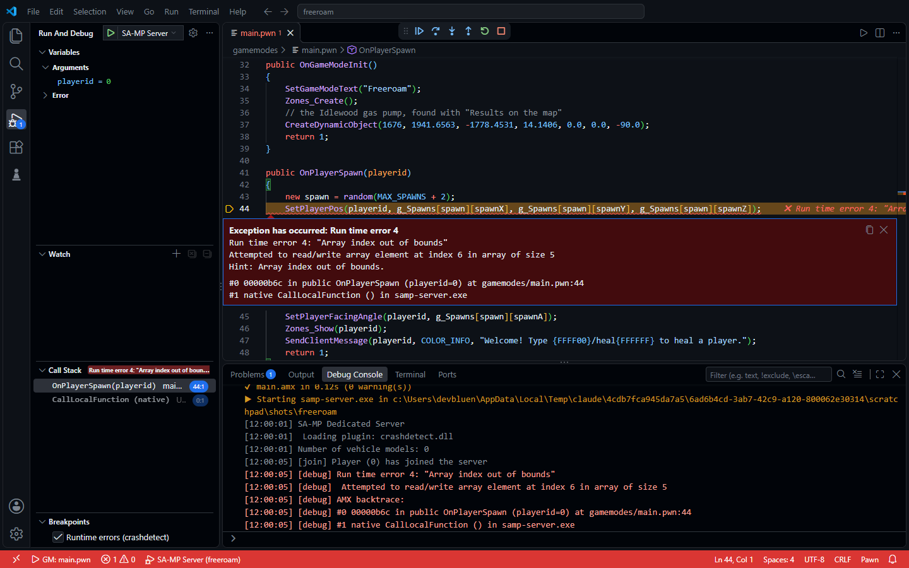

**F6**, the ▶ button in the *Server* view, or Run and Debug → *SA-MP / open.mp Server*:

1. compiles the gamemode (and stops if there are errors);
2. warns if `server.cfg` loads a different gamemode;
3. starts `samp-server.exe` / `omp-server.exe` and streams the log to the **Debug Console**;
4. when **crashdetect** reports an error (array index out of bounds, native failed, hang…):
   - VS Code **stops at the exact line** with the error message and a hint;
   - the **call stack** shows each function with its file and line;
   - the **Variables** view shows each function's arguments (`playerid = 0`, `cmdtext = "/test"`);
   - the server keeps running: **Continue (F5)** moves on;
5. the Debug Console **REPL** sends commands to the server: via RCON on SA-MP (needs
   `rcon_password`), via the console on open.mp.

> SA-MP doesn't support breakpoints or stepping. The debugger shows **where** and **why** an error
> happened. Install crashdetect (search "crashdetect" in Packages) and keep `-d3` in the compiler
> arguments.

## "Pawn" sidebar

- **Compilation:**
  - result of the last compilation or check, with duration and time;
  - target and `.amx` size;
  - clickable errors and warnings;
  - compiler and include folders.
- **Packages:** direct and indirect dependencies with their state (installed, up to date, update
  available, missing), plugins and include paths, with inline actions.
- **Server:**
  - running or stopped;
  - executable (SA-MP or open.mp), `server.cfg`, gamemode and port;
  - server log;
  - plugins, warning when a file is missing from `plugins/`;
  - history of **runtime errors** with a clickable call stack.

## Settings

| Setting | Default | Description |
|---|---|---|
| `pawnStudio.language` | `auto` | extension language (`auto`, `en`, `pt-br`) |
| `pawnStudio.compilerPath` | `""` | path to `pawncc` (empty = automatic) |
| `pawnStudio.includePaths` | `[]` | extra include folders |
| `pawnStudio.args` | `["-;+", "-(+", "-d3"]` | compiler arguments |
| `pawnStudio.outputDirectory` | `""` | `.amx` folder |
| `pawnStudio.entry` | `""` | pinned target |
| `pawnStudio.saveBeforeCompile` | `true` | save before compiling |
| `pawnStudio.lint.quick` | `true` | quick analysis while typing |
| `pawnStudio.lint.onType` | `true` | background `pawncc` without saving |
| `pawnStudio.lint.delay` | `1500` | idle ms before calling `pawncc` |
| `pawnStudio.lintOnSave` | `true` | background check on save |
| `pawnStudio.completion.parameters` | `required` | parameters inserted by autocomplete |
| `pawnStudio.revealOutput` | `onError` | when to show the output |
| `pawnStudio.errorLens.*` | — | error lens (enable, warnings, other languages) |
| `pawnStudio.server.path` | `""` | `samp-server.exe` / `omp-server.exe` |
| `pawnStudio.packages.checkUpdatesOnStartup` | `true` | check updates when opening |
| `pawnStudio.gtaPath` | `""` | GTA San Andreas folder for the tools (empty = automatic) |
| `pawnStudio.dialogs.codeStyle` | `auto` | Dialog Creator code: `auto`, `native`, `easy` |

## Development

```
npm install
npm test            # unit + grammar + translation tests
npm run test:live   # real GitHub integration (installs crashdetect + streamer in a temp folder)
npm run test:vscode -- <pawncc.exe> <include-folder>...   # runs everything inside a real VS Code
npm run package     # builds the .vsix
```

### Translations

- Code messages use `t('English text {0}', value)` (`src/i18n.ts`). Translations live in
  `l10n/bundle.l10n.<locale>.json`.
- Menus and settings use `package.nls.json` / `package.nls.<locale>.json`.
- `npm test` fails if a message has no translation or the placeholders don't match.
- To add a language, copy the `pt-br` files, translate them, and add the locale to the
  `pawnStudio.language` setting.
