# Pawn Studio — SA-MP / open.mp

> 🇺🇸 [Read in English](README.md)

Um ambiente completo de Pawn no VS Code:

- compilação a partir de **qualquer** arquivo;
- sintaxe e IntelliSense;
- error lens ao vivo;
- gerenciador de pacotes via GitHub, com faixas de versão, que instala plugins e includes de qualquer repositório;
- depuração do servidor com crashdetect;
- ferramentas: editor de Attached Objects (jogador e veículo, em 3D), buscador de objetos (3D, resultados e áreas no mapa), buscador de sprites, preview de animações (3D), player de sons, Dialog Creator e GangZone Creator.

A extensão está disponível em **Português (Brasil)** e **English**. Ela segue o idioma do VS Code, ou
você pode forçar um idioma com `pawnStudio.language`.

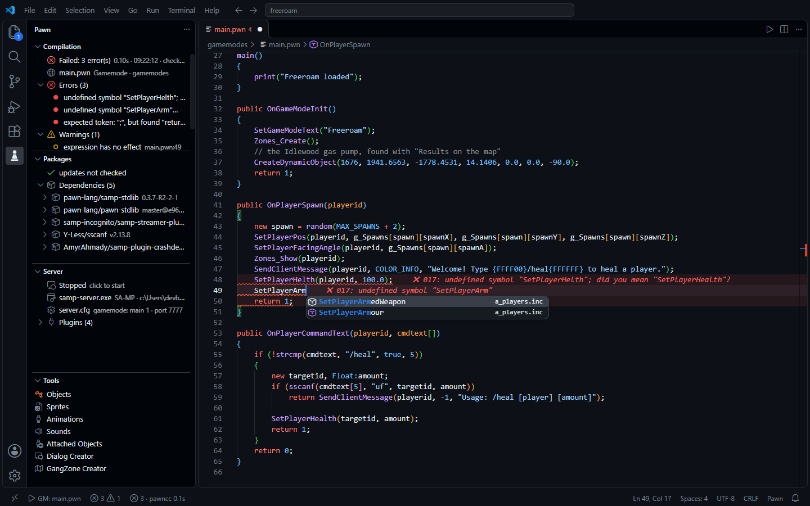

| Atalho | O que faz |
|---|---|
| **F5** / **Ctrl+Shift+B** | compila o gamemode/filterscript do arquivo aberto |
| **F6** | compila e inicia o servidor com o depurador |
| **F12** | vai para a definição (inclusive dentro das includes) |
| **Ctrl+Espaço** | autocompletar com natives, stocks, defines e enums de toda a árvore de includes |

---

## Compilar de qualquer arquivo

A extensão lê os `#include` do projeto, ignorando os comentados, e descobre qual gamemode ou
filterscript usa o arquivo aberto, mesmo com vários níveis de módulos. A barra de status mostra o
alvo (`▶ GM: main.pwn` / `▶ FS: admin.pwn`) e o motivo da escolha.

Ordem de decisão:

1. alvo fixado (*Pawn: Fixar alvo de compilação*);
2. `// @entry ../gamemodes/main.pwn` no topo do arquivo;
3. o arquivo **é** um principal;
4. o único principal que inclui o arquivo; se forem vários, pergunta uma vez e lembra;
5. arquivo ainda não incluído por ninguém → último alvo, `entry` do `pawn.json` ou o único gamemode.

Um `.pwn` conta como **principal** quando:

- tem `main()` ou `#define FILTERSCRIPT`, **ou**
- está em `gamemodes/` ou `filterscripts/` e define `OnGameModeInit` / `OnFilterScriptInit`.

Um candidato que é incluído por outro principal deixa de ser principal. Assim, módulos com hook ALS
não são confundidos com gamemodes.

## Painel "Pawn Studio"

Toda compilação aparece na aba **Pawn Studio** do painel de baixo (ao lado de Problems, Output e
Terminal):

- o alvo, a hora e quanto tempo levou;
- o tamanho do `.amx` e quanto ele cresceu ou diminuiu desde a compilação anterior;
- a memória que o script precisa (cabeçalho, código, dados e pilha/heap com o uso estimado), tirada
  do resumo do pawncc;
- os erros e avisos: clique num deles para ir até a linha;
- em **Detalhes**: o compilador, as pastas de include e a linha de comando.

A mesma aba guarda o log do gerenciador de pacotes e o log do servidor nas sessões de depuração. Os
filtros no topo separam por tipo. A configuração `pawnStudio.revealOutput` escolhe quando a aba abre:
em toda compilação (padrão), só quando dá erro, ou nunca.

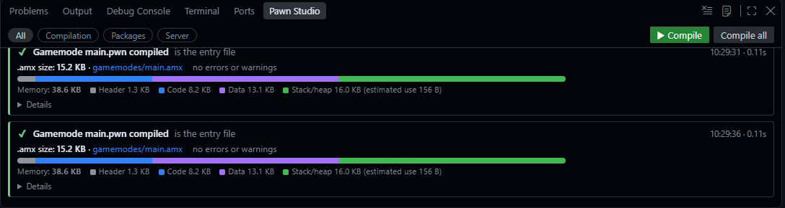

## Error lens ao vivo

Os erros aparecem **no fim da própria linha** enquanto você digita, sem precisar salvar. São duas
camadas:

1. **Análise rápida, a cada tecla (~20 ms)**, feita pela própria extensão. Aponta:
   - chave, parêntese ou colchete sem par;
   - string sem fechar;
   - `;` faltando (quando o projeto usa `-;+` / `#pragma semicolon 1`);
   - `#include` que não existe;
   - função indefinida, com sugestão (*você quis dizer "SetPlayerPos"?*);
   - número errado de argumentos.

   Ela entende multilinhas com `\`, macros de prefixo (`Dialog:`, `CMD:`, `Inventario:` → `IV_`),
   y_timers, `inline` e funções `static`.
2. **`pawncc` em segundo plano, sem salvar:**
   - compila uma cópia temporária do projeto que inclui o texto ainda não salvo;
   - em gamemodes grandes (YSI) isso leva o tempo do próprio `pawncc`, e a barra de status mostra
     `pawncc 12s` enquanto roda;
   - não é cancelado a cada tecla: fica em fila, e o resultado é ajustado às edições feitas enquanto
     compilava.

Os erros **acompanham o texto**: inserir linhas desloca os avisos, e editar uma linha com erro tira
o aviso na hora.

## Sintaxe e IntelliSense

- **Gramática completa:** tags (`Float:`), format specifiers (`%d`, `%s`, `{FF0000}`), packed strings,
  `#define` com `%0`, palavras do YSI (`hook`, `foreach`, `inline`, `timer`) e `CMD:`.
- **Autocompletar** a partir da árvore de includes do alvo, incluindo nomes de arquivo dentro de
  `#include <`.
- **Parâmetros preenchidos:** ao aceitar uma função com Tab ou Enter, ela vem com os parâmetros
  obrigatórios como campos, e o **Tab** pula de um para o outro:
  - `SetPlayerPos(playerid, x, y, z)`;
  - `GetPlayerName(playerid, name)` (o `len = sizeof name` tem valor padrão e fica de fora).

  Configuração: `pawnStudio.completion.parameters`.
- **Dicas de parâmetros**, **hover** com a documentação (os comentários XML da stdlib viram texto
  formatado), **F12**, **outline** e busca de símbolos.
- **54 snippets:** callbacks do SA-MP, dialogs, timers, comandos, enums, `foreach`, hooks…

## Gerenciador de pacotes (GitHub)

Funciona como o npm, com um formato próprio de `pawn.json`, e instala **qualquer** repositório do
GitHub.

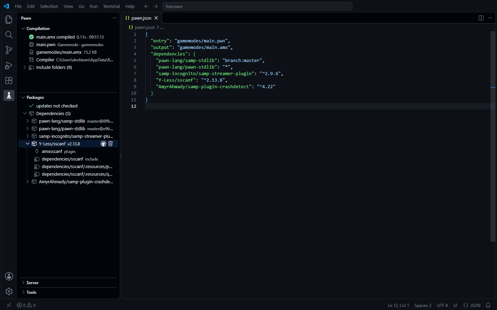

O pacote não precisa ter sido feito para o Pawn Studio. Quando o repositório não tem `pawn.json`, a
extensão descobre sozinha:

- onde estão os `.inc` (`include/`, `pawno/include` ou a raiz do repositório);
- qual arquivo do **release** tem o plugin do seu sistema:
  - Windows: `-win32.zip`, `.dll`;
  - Linux: `-linux.tar.gz`, `.so`;
  - a versão 32 bits tem preferência sobre a de 64;
- o que é cada arquivo dentro do pacote:
  - **plugins** (`plugins/`) são copiados para `plugins/` e registrados na configuração do servidor;
  - **componentes do open.mp** (`components/`) são copiados para `components/`;
  - **bibliotecas** que o plugin precisa (por exemplo, `libmariadb.dll` e `log-core.dll` do MySQL)
    vão para a pasta do executável do servidor.

### Buscar e instalar

Na barra lateral Pawn, abra **Pacotes** e clique em `+`:

- a busca vai direto ao GitHub (repositórios com o tópico `pawn-package`, mais os repositórios de
  SA-MP);
- você escolhe a versão:
  - `^2.9.6` (recomendado): recebe atualizações compatíveis;
  - uma versão exata;
  - uma branch.

### Ao instalar um pacote

- o código vai para `.pawn-studio/dependencies/`;
- plugins, componentes e bibliotecas vão para o servidor, como descrito acima;
- os plugins são registrados no `server.cfg` (SA-MP) ou no `config.json` (open.mp);
- as pastas de include entram no compilador e no IntelliSense, sem configurar nada;
- os `.inc` também são copiados para o `pawno/include` (SA-MP) ou `qawno/include` (open.mp) do servidor,
  para o pawno/qawno e outras ferramentas acharem. Um arquivo que já estava lá e não foi instalado pelo
  Pawn Studio nunca é sobrescrito, e as cópias saem junto com o pacote. Desligue com
  `pawnStudio.packages.copyIncludes`;
- os pacotes que o próprio pacote lista no `pawn.json` dele também são instalados. Se o seu projeto
  pede outra versão do mesmo pacote, vale a do seu projeto.

### Atualizações

A visão mostra cada pacote em um destes estados:

- **✓**: atualizado.
- **`v2.9.4 → v2.9.6`**: há uma versão mais nova dentro da faixa do `pawn.json`. Atualizar é seguro.
- **`v2.9.6 · v3.0.0 disponível`**: existe uma versão **major** nova, fora da faixa. Atualizar
  pede confirmação, porque pode quebrar o seu código, e depois muda o `pawn.json` para `^3.0.0`.
- **não instalado**: o pacote está no `pawn.json`, mas falta em `.pawn-studio/dependencies/`.

### Arquivo de trava e remoção

- **`pawn-lock.json`:** guarda a tag e o commit exatos de cada pacote. Quem clonar o projeto recebe
  exatamente o mesmo código com **Instalar dependências do pawn.json**.
- **Remover:** apaga os arquivos, os plugins e as bibliotecas, tira o plugin do `server.cfg` e limpa
  as dependências que mais nada usa.

### Limites do GitHub

Sem login, o GitHub permite 60 requisições por hora e 10 buscas por minuto. *Pawn: Entrar no GitHub*
usa a conta já conectada ao VS Code e sobe o limite para 5000 por hora.

---

## Como criar o `pawn.json`

O `pawn.json` fica na **raiz do servidor** (a pasta que contém `gamemodes/`). Ele diz à extensão:

- qual arquivo é o gamemode;
- onde gravar o `.amx`;
- quais pacotes o projeto usa, e em quais versões.

### Opção 1 — pelo comando (recomendado)

1. Abra a pasta do servidor no VS Code.
2. Rode **Pawn: Criar pawn.json** pela paleta de comandos (`Ctrl+Shift+P`), ou clique em **Criar
   pawn.json** na visão *Pacotes*.
3. O arquivo é criado com o gamemode detectado:

```json
{
	"name": "meu-servidor",
	"version": "1.0.0",
	"entry": "gamemodes/main.pwn",
	"output": "gamemodes/main.amx",
	"dependencies": {}
}
```

Você não precisa escrever as dependências à mão. Ao instalar um pacote com **Instalar pacote...**, a
extensão o adiciona em `dependencies` com a versão escolhida.

### Opção 2 — à mão

Crie um arquivo `pawn.json` na raiz do servidor. O editor valida e autocompleta os campos enquanto
você digita.

```json
{
	"name": "meu-servidor",
	"version": "1.0.0",
	"entry": "gamemodes/main.pwn",
	"output": "gamemodes/main.amx",
	"dependencies": {
		"samp-incognito/samp-streamer-plugin": "^2.9.6",
		"pBlueG/SA-MP-MySQL": "^R41-4",
		"pawn-lang/YSI-Includes": "branch:5.x"
	},
	"devDependencies": {
		"AmyrAhmady/samp-plugin-crashdetect": "^4.22"
	}
}
```

Depois rode **Pawn: Instalar dependências do pawn.json** (ou o botão ☁ na visão *Pacotes*).

### Campos

| Campo | Obrigatório | Descrição |
|---|---|---|
| `name` | não | nome do projeto |
| `version` | não | versão do projeto (para a sua referência) |
| `entry` | recomendado | arquivo `.pwn` principal, relativo ao `pawn.json` |
| `output` | não | `.amx` a gerar (padrão: ao lado do `.pwn`) |
| `dependencies` | não | `{ "usuario/repo": "versão" }`: pacotes do GitHub (veja as versões abaixo) |
| `devDependencies` | não | mesmo formato; pacotes usados só no desenvolvimento (ex.: crashdetect) |
| `target` | não | quais builds os pacotes instalam (servidor, sistema, arquitetura, variante), veja [Configurações do projeto](#configurações-do-projeto-target-e-compiler) |
| `compiler` | não | `path`, `args` e `includes` do pawncc deste projeto |
| `supports` | só pacotes | servidores para quem o pacote é: `samp`, `openmp` ou os dois |
| `include` | só pacotes | pasta(s) com os `.inc` que você exporta (opcionalmente por servidor) |
| `plugins` | só pacotes | qual arquivo da release tem os binários, por sistema / arquitetura / variante |
| `components` | só pacotes | o arquivo do component do open.mp, quando é separado de `plugins` |

### Versões

A chave é o repositório no GitHub (`usuario/repo`). O valor diz qual versão instalar.

| Valor | Instala |
|---|---|
| `"^2.9.6"` | a versão **2.x.x** mais nova que seja no mínimo 2.9.6 (padrão ao instalar) |
| `"~2.9.6"` | a versão **2.9.x** mais nova (só correções) |
| `"2.9.6"` | exatamente a 2.9.6 (a tag `v2.9.6` ou `2.9.6`) |
| `"2.x"`, `">=1.2 <2"`, `"^1 \|\| ^2"` | qualquer versão dentro da faixa |
| `"latest"` | a versão mais nova (ou a branch padrão, se o repositório não tiver tags) |
| `"tag:r1-final"` | uma tag pelo nome exato, para tags que não são números de versão |
| `"branch:dev"` | o commit mais novo da branch (o commit fica travado no `pawn-lock.json`) |
| `"commit:a1b2c3d"` | exatamente esse commit |

Funcionam tags nos estilos `v1.2.3` e `1.2.3`, e também o estilo do SA-MP `R41-4`, lido como `41.4`.
Pré-lançamentos (`-beta`, `-rc1`) só são instalados quando a versão que você pede cita um.

### O que vai para o git

- ✅ `pawn.json` e `pawn-lock.json`: quem clonar o projeto recebe as mesmas versões com *Instalar
  dependências do pawn.json*.
- ❌ `.pawn-studio/`: os pacotes baixados. É baixada de novo a partir do lock e tem o próprio
  `.gitignore`, então o git ignora sem você fazer nada. (Projetos de versões antes da 1.4 tinham uma
  pasta `dependencies/`: os pacotes vão sozinhos para `.pawn-studio/dependencies/`.)

### Publicar o seu próprio pacote

Ache o seu caso abaixo, copie o `pawn.json` dele para a raiz do seu repositório e dê os mesmos nomes aos
arquivos da release. Depois:

1. faça commit do `pawn.json` **antes** de criar a tag: quem instala lê o `pawn.json` que está dentro
   da tag (`v1.0.0`), não o da sua branch principal;
2. crie a release no GitHub para essa tag e anexe os arquivos;
3. rode **Pawn: Conferir meu pacote** (aba Pacotes → ⋯): ele lista o que o SA-MP e o open.mp recebem em
   cada sistema e avisa o que estiver faltando;
4. adicione o tópico **`pawn-package`** ao repositório, para ele aparecer na busca.

| O seu pacote | Caso |
|---|---|
| só arquivos `.inc` | [A](#a-só-include) |
| um plugin de SA-MP (o open.mp também carrega) | [B](#b-plugin-de-sa-mp) |
| só um component do open.mp | [C](#c-só-component-do-openmp) |
| um plugin **e** um component, no mesmo arquivo | [D](#d-plugin-e-component-no-mesmo-arquivo) |
| um plugin **e** um component, em arquivos separados | [E](#e-plugin-e-component-em-arquivos-separados) |
| uma pasta por servidor dentro do arquivo (`samp/…`, `open.mp/…`) | [D2](#d2-uma-pasta-por-servidor-dentro-do-arquivo) |
| qualquer outra organização dentro do arquivo | [G](#g-diga-onde-fica-cada-arquivo-layout) |
| builds para vários sistemas / 64 bits / dinâmica | [F](#f-vários-sistemas-arquiteturas-e-variantes) |

#### A. Só include

Não precisa de `pawn.json` nem de release: suba o repositório e crie tags de versão. Os `.inc` são
encontrados sozinhos (uma pasta `include/`, ou a raiz do repositório). Coloque um `pawn.json` só para
listar dependências:

```json
{ "dependencies": { "pawn-lang/samp-stdlib": "latest" } }
```

#### B. Plugin de SA-MP

Arquivos da release:

```text
meuplugin-1.0.0-win32.zip         meuplugin-1.0.0-linux.tar.gz
├─ plugins/meuplugin.dll          ├─ plugins/meuplugin.so
└─ include/meuplugin.inc          └─ include/meuplugin.inc
```

```json
{
	"supports": "samp",
	"plugins": {
		"windows": "meuplugin-*-win32.zip",
		"linux": "meuplugin-*-linux.tar.gz"
	}
}
```

| Servidor | Recebe |
|---|---|
| SA-MP | `plugins/meuplugin.dll` + `plugins meuplugin` no `server.cfg` |
| open.mp | o mesmo arquivo como legacy plugin, em `pawn.legacy_plugins` do `config.json` |

#### C. Só component do open.mp

```text
meucomponent-1.0.0-win32.zip      meucomponent-1.0.0-linux.tar.gz
├─ components/meucomponent.dll    ├─ components/meucomponent.so
└─ include/meucomponent.inc       └─ include/meucomponent.inc
```

```json
{
	"supports": "openmp",
	"plugins": {
		"windows": "meucomponent-*-win32.zip",
		"linux": "meucomponent-*-linux.tar.gz"
	}
}
```

| Servidor | Recebe |
|---|---|
| open.mp | `components/meucomponent.dll` (components carregam sozinhos, sem configuração) |
| SA-MP | nada: o log da instalação avisa que o pacote é só para open.mp |

Com `"supports": "openmp"`, `.dll`/`.so` soltos na raiz do arquivo também contam como components.

#### D. Plugin e component no mesmo arquivo

Um arquivo por sistema, com as duas builds dentro:

```text
audio-cast-1.0.3-windows-x86.zip
├─ plugins/audio-cast.dll         ← SA-MP
├─ components/audio-cast.dll      ← open.mp
└─ include/audio-cast.inc
```

```json
{
	"supports": ["samp", "openmp"],
	"plugins": {
		"windows": "audio-cast-*-windows-x86.zip",
		"linux": "audio-cast-*-linux-x86.zip"
	}
}
```

| Servidor | Recebe |
|---|---|
| SA-MP | `plugins/audio-cast.dll` + `server.cfg` (o component é ignorado) |
| open.mp | `components/audio-cast.dll` (o plugin é ignorado, para nunca carregar duas vezes) |

#### D2. Uma pasta por servidor dentro do arquivo

Os arquivos de cada servidor numa pasta própria, do jeito que ficariam naquele servidor:

```text
PawnJson-1.0.0-windows-x86.zip
├─ samp/
│  ├─ plugins/PawnJson.dll
│  └─ pawno/include/PawnJson.inc
└─ open.mp/
   ├─ components/PawnJson.dll
   └─ qawno/include/PawnJson.inc
```

```json
{
	"supports": ["samp", "openmp"],
	"plugins": {
		"windows": "PawnJson-*-windows-x86.zip",
		"linux": "PawnJson-*-linux-x86.zip"
	}
}
```

O SA-MP usa só a pasta `samp/` (plugin, `server.cfg` e o include dela); o open.mp usa só a `open.mp/`
(component e o include dela). Nomes de pasta reconhecidos: `samp`, `sa-mp`, `legacy` e `open.mp`,
`openmp`, `omp`, na raiz do arquivo ou um nível abaixo. Com outros nomes de pasta, declare-os com o
[`layout`](#g-diga-onde-fica-cada-arquivo-layout).

#### G. Diga onde fica cada arquivo: `layout`

Quando o arquivo é organizado do seu jeito, diga onde fica cada tipo de arquivo, por servidor. Os
caminhos são relativos à raiz do arquivo (uma pasta única no topo, como `minhalib-1.0/`, é atravessada
sozinha):

```text
minhalib-1.0.0-win32.zip
└─ minhalib-1.0.0/
   ├─ bin/legacy/minhalib.dll
   ├─ bin/omp/minhalib.dll
   ├─ inc/samp/minhalib.inc
   ├─ inc/omp/minhalib.inc
   └─ libs/libcurl.dll
```

```json
{
	"supports": ["samp", "openmp"],
	"plugins": { "windows": "minhalib-*-win32.zip", "linux": "minhalib-*-linux.tar.gz" },
	"layout": {
		"samp":   { "plugins": "bin/legacy", "include": "inc/samp" },
		"openmp": { "components": "bin/omp/minhalib.dll", "include": "inc/omp" },
		"all":    { "libraries": "libs/*.dll" }
	}
}
```

| Papel | Vai para |
|---|---|
| `plugins` | `plugins/` do servidor, adicionado ao `server.cfg` / `config.json` |
| `components` | `components/` |
| `libraries` | ao lado do executável do servidor |
| `include` | os includes |

- Cada valor é uma pasta (`"bin/legacy"`), um padrão (`"bin/omp/*.dll"`) ou uma lista deles.
- `samp` é usado em servidores SA-MP, `openmp` em servidores open.mp, `all` nos dois.
- Dessas pastas, só entram os `.dll` (Windows) ou `.so` (Linux) do sistema que está sendo instalado.
- Com `layout`, **só o que ele lista é instalado**: sem detecção. Um caminho que não existe no arquivo
  aparece no log da instalação e no **Pawn: Conferir meu pacote**.

#### E. Plugin e component em arquivos separados

```text
meuplugin-1.0.0-win32.zip         meuplugin-omp-1.0.0-win32.zip
└─ plugins/meuplugin.dll          └─ components/meuplugin.dll
```

```json
{
	"supports": ["samp", "openmp"],
	"plugins":    { "windows": "meuplugin-*-win32.zip",     "linux": "meuplugin-*-linux.tar.gz" },
	"components": { "windows": "meuplugin-omp-*-win32.zip", "linux": "meuplugin-omp-*-linux.tar.gz" }
}
```

O SA-MP baixa só o arquivo de `plugins`; o open.mp baixa só o de `components`. Um arquivo que um padrão
de `components` pega nunca é usado como plugin, mesmo que o padrão de `plugins` também pegue.

#### F. Vários sistemas, arquiteturas e variantes

Uma chave por build. As chaves `windows` / `linux` sozinhas são as builds 32 bits, que é o que o SA-MP e
o open.mp carregam:

```json
{
	"plugins": {
		"windows":       "minhalib-*-win32.zip",
		"windows-x64":   "minhalib-*-win64.zip",
		"linux":         "minhalib-*-linux-static.tar.gz",
		"linux-dynamic": "minhalib-*-linux-dynssl.tar.gz"
	}
}
```

Quem instala escolhe a build com `"target"` no `pawn.json` do projeto (veja
[Configurações do projeto](#configurações-do-projeto-target-e-compiler)): `{ "os": "linux", "variant": "dynamic" }`.
Uma variante que o pacote não tem cai na chave simples daquele sistema.

#### Referência

| Campo | Valores |
|---|---|
| `supports` | `"samp"`, `"openmp"` ou `["samp", "openmp"]` (padrão) |
| `plugins` | `{ chave: "padrão do arquivo" }` — o arquivo com os binários (`*` = qualquer coisa); `false` = sem binários; sem o campo = escolhido pelo nome dos arquivos |
| `components` | mesmo formato; só quando o component do open.mp é um arquivo separado |
| `include` | `"include"`, `["a", "b"]` ou `{ "samp": "...", "openmp": "...", "all": "..." }`; sem o campo = detectado |
| `layout` | onde fica cada tipo de arquivo dentro do arquivo da release, por servidor — veja [G](#g-diga-onde-fica-cada-arquivo-layout) |
| `dependencies` | pacotes que o seu precisa, instalados junto com ele. A forma em lista do sampctl (`["usuario/repo", "usuario/repo:tag"]`) também funciona |

Chaves de `plugins` / `components`: `windows`, `linux`, `windows-x64`, `linux-x64` e variantes como
`linux-dynamic`, `linux-static` ou `linux-x86-dynamic`. O valor também pode ser uma lista de padrões.

Dentro do arquivo da release:

| Caminho | Vai para |
|---|---|
| `plugins/*.dll` / `plugins/*.so` | `plugins/` do servidor, adicionado ao `server.cfg` / `config.json` |
| `components/*.dll` / `components/*.so` | `components/` (só open.mp) |
| outros `.dll` / `.so` (quando existe uma pasta `plugins/`) | ao lado do executável do servidor (bibliotecas como `libmariadb.dll`) |
| pastas com `.inc` | os includes, antes do código do repositório |
| `samp/…` e `open.mp/…` (uma pasta por servidor) | só a pasta do servidor do projeto é usada |

Um `pawn.json` que já tem campos do sampctl (`user`, `repo`, `include_path`, `resources`) pode mantê-los:
adicione os campos do Pawn Studio ao lado e o mesmo arquivo serve às duas ferramentas. Arquivos
dentro do arquivo da release (um `.tar.gz` dentro de um `.zip`) também são abertos.

Quando a release traz os `.inc`, o código-fonte do repositório (SDKs, C++) não fica na pasta
`.pawn-studio/dependencies/` de quem instalou.

### Configurações do projeto: `target` e `compiler`

O `pawn.json` do seu projeto (na pasta do servidor) guarda configurações que são do projeto, para todo
mundo que abrir ter as mesmas:

```json
{
	"entry": "gamemodes/main.pwn",
	"target": { "os": ["windows", "linux"] },
	"compiler": {
		"path": "pawno/pawncc.exe",
		"args": ["-d3", "-;+", "-(+"],
		"includes": ["pawno/include"]
	}
}
```

**`target`** — quais builds os pacotes instalam:

| Chave | Padrão | Exemplo |
|---|---|---|
| `os` | o sistema do servidor da pasta (ou desta máquina) | `["windows", "linux"]`: testa no Windows, hospeda no Linux — o `.dll` e o `.so` vão os dois para `plugins/` |
| `server` | detectado pelo `samp-server` / `omp-server` | `"openmp"` |
| `arch` | `"x86"` (o que o SA-MP e o open.mp carregam) | `"x64"` |
| `variant` | a build padrão | `"dynamic"`, `"static"` |

Com vários sistemas, o arquivo de configuração (`server.cfg` / `config.json`) é escrito para o servidor
da pasta. Um servidor SA-MP no Linux precisa do `.so` no nome (`plugins streamer.so`): o log da
instalação mostra essa linha para o outro sistema.

**`compiler`** — o `path` do pawncc, os `args` e `includes` extras (caminhos relativos ao `pawn.json`).
Eles têm prioridade sobre as configurações `pawnStudio.compilerPath`, `pawnStudio.args` e
`pawnStudio.includePaths`.

---

## Ferramentas: objetos, sprites, animações, sons e dialogs

A seção **Ferramentas** da barra lateral Pawn abre sete ferramentas. Todas inserem o código no
cursor do arquivo em que você estava.

Os buscadores leem modelos, texturas, animações e sons direto da **sua própria instalação do GTA San
Andreas**: nenhum arquivo do jogo vem junto com a extensão. A pasta do jogo é detectada sozinha
(chave de registro do SA-MP, depois pastas comuns de instalação). Se não for encontrada, escolha com
**Pawn: Selecionar a pasta do GTA San Andreas** ou com a configuração `pawnStudio.gtaPath`. Para usar
outra cópia do jogo depois, clique em **Trocar pasta**, no canto de cima dos buscadores, ou no item
**GTA San Andreas**, no fim da seção Ferramentas (ele mostra a pasta em uso).

| Ferramenta | O que faz | Insere |
|---|---|---|
| **Objetos** | todos os objetos do GTA e do SA-MP (`SAMP.ide`), com busca por ID, modelo ou textura e preview 3D texturizado. Filtros de origem, tipo (estático, por horário, animado), uso no mapa, LODs e distância de visão. Cada objeto mostra todos os lugares onde o jogo coloca ele no mapa. **Resultados no mapa**: busque um nome (`pump`, `atm`…) e veja onde fica cada objeto encontrado, com a posição e a rotação reais. **Área no mapa**: arraste um retângulo no mapa de San Andreas para listar todos os objetos dentro dele | `CreateObject`, `CreateDynamicObject`, `RemoveBuildingForPlayer` (um objeto, todas as cópias de um modelo ou uma área inteira), `SetPlayerPos` e todas as posições de um modelo como array Pawn |
| **Sprites** | todos os sprites de TextDraw de `models/txd` (`ld_beat:chit`, `ld_tatt:9crown`…), mostrados como imagem, com o tamanho | um TextDraw global ou do jogador já com a fonte de sprite e o tamanho |
| **Animações** | todas as bibliotecas de animação (`PED`, `DANCING`, `BAR`…), tocando em 3D em qualquer skin, com controles de repetir, "no lugar" e velocidade | `ApplyAnimation(playerid, "LIB", "NOME", …)` |
| **Sons** | todos os IDs de som com o nome do próprio jogo (`1139 · SOUND_CHECKPOINT_RED`). Os 🔊 **tocam no editor** com os mesmos sons de banco que o jogo usa. A visão "Todos os sons do jogo" deixa escutar os ~62.000 sons do `audio/SFX` e salvar qualquer um como `.wav` | `PlayerPlaySound(…)` com o nome em comentário |
| **Attached Objects** | editor 3D para posicionar objetos no jogador (qualquer skin, 18 ossos, posição, rotação, escala e cores do material) ou num veículo (qualquer veículo e cor). Move, gira e escala com o mouse; navegador de objetos com miniaturas (chapéus, capacetes, óculos, máscaras…) | `SetPlayerAttachedObject`, ou `CreateObject` + `AttachObjectToVehicle` (`CreateDynamicObject` + `AttachDynamicObjectToVehicle` com o streamer) |
| **GangZone Creator** | desenha gang zones no mapa de San Andreas: retângulos, círculos e polígonos (ponto a ponto). Move e redimensiona com o mouse, escolhe cor e opacidade, ou digita as coordenadas | `GangZoneCreate` + `GangZoneShowForPlayer`/`ForAll` e, com o streamer, `CreateDynamicRectangle` / `CreateDynamicCircle` / `CreateDynamicPolygon` com `OnPlayerEnterDynamicArea` |
| **Dialog Creator** | monta um dialog visualmente, em todos os estilos, com preview igual ao do jogo, cores `{RRGGBB}` e o tratamento da resposta | `ShowPlayerDialog` + `OnDialogResponse`, ou easyDialog `Dialog_Show` + `Dialog:nome` |

**Resultados no mapa:** todos os lugares onde ficam os objetos que você buscou, com a posição e a rotação reais.

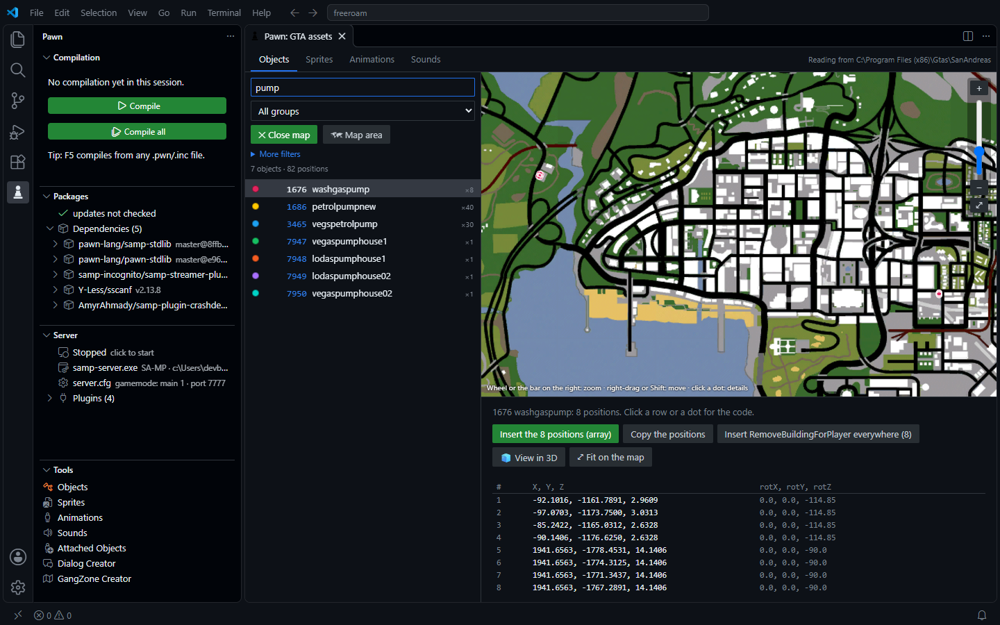

**Preview dos objetos** com as texturas do próprio jogo:

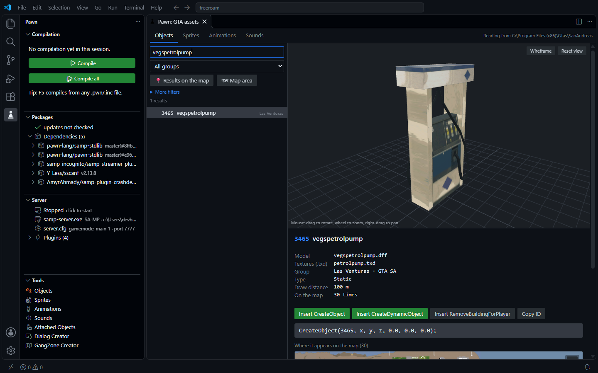

**Attached Objects:** posicione objetos no jogador ou num veículo em 3D.

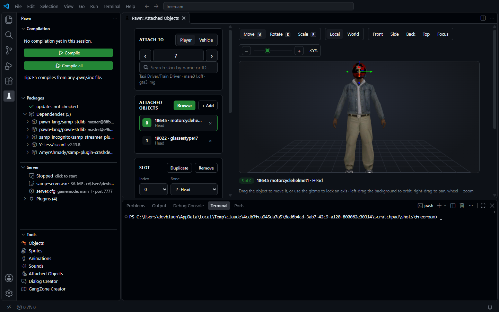

**GangZone Creator:** retângulos, círculos e polígonos, com áreas do streamer.

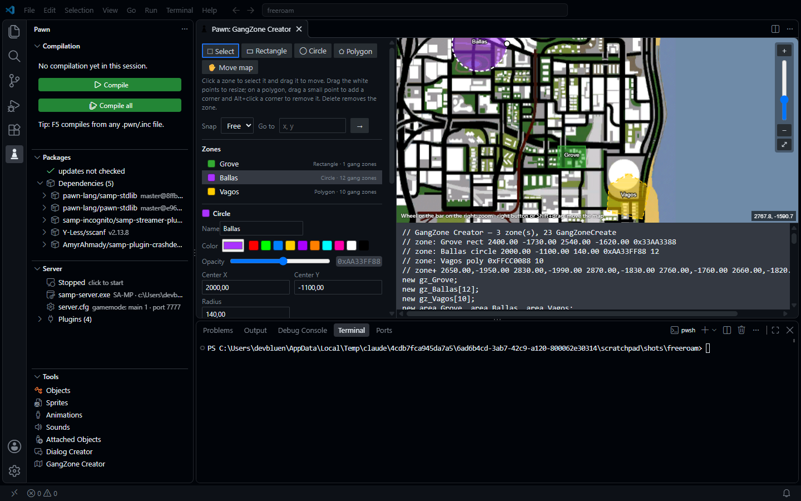

**Dialog Creator:** preview igual ao do jogo.

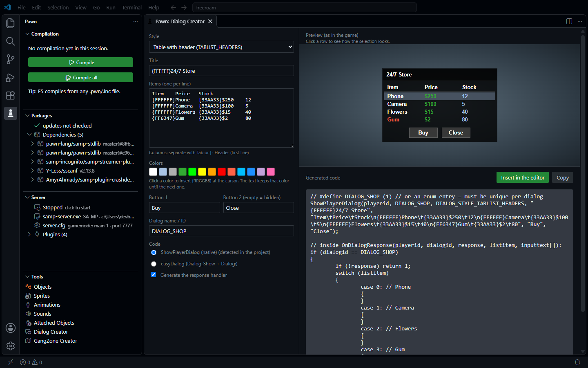

**Animações** em 3D em qualquer skin, e **sons** que tocam no editor:

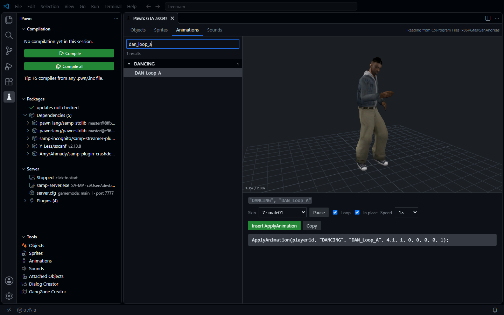

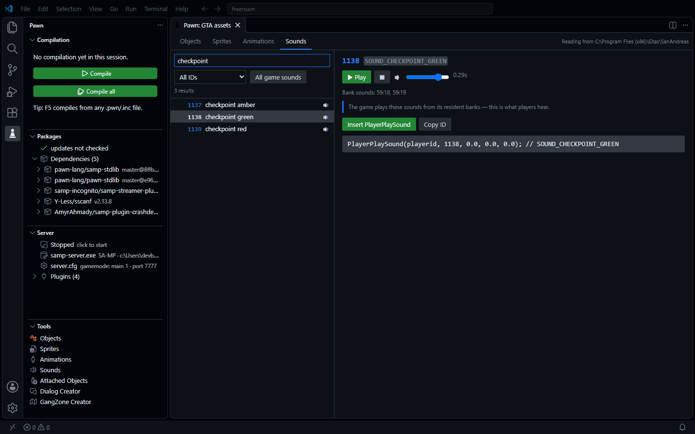

- **Detalhes do Dialog Creator:**
  - Com o cursor em um `ShowPlayerDialog` ou `Dialog_Show` existente, o criador abre preenchido com
    aquele dialog. Ele também está no menu do botão direito do editor.
  - O estilo do código segue o seu projeto: easyDialog quando ele já usa `Dialog_Show`.
  - Textos longos são montados com `strcat`, para nenhuma linha passar do limite do compilador.
- **Texto do dialog:** digite `\t` e `\n` como no Pawn, ou aperte Tab na caixa de texto. Os dois viram
  colunas nos dialogs `TABLIST`. O SA-MP mostra no máximo 4 colunas (3 tabs por linha): o Dialog
  Creator avisa quando uma linha passa disso e deixa as colunas extras fora do código.
- **Attached Objects:** o editor vem do
  [SA-MP Preview Studio](https://github.com/devbluen/samp-preview-studio), com os modelos lidos do seu
  jogo. Com o cursor em linhas de `SetPlayerAttachedObject` ou `AttachObjectToVehicle` (ou com elas
  selecionadas), rode **Pawn: Attached Objects** ou use o menu do botão direito: elas abrem no editor, e
  **Inserir tudo no editor** escreve o resultado de volta. Atalhos: W mover, E girar, R escalar, F focar.
- **Skins e modelos personalizados:** os modelos do jogo são lidos do jeito que o jogo carrega: primeiro
  a pasta `modloader/` (`.dff`/`.txd` soltos, e IDs novos de skin dos `.ide` dela), depois os IMGs extras
  do `data/gta.dat`, depois os arquivos padrão. Assim, uma skin trocada pelo modloader ou dentro do
  `gta3.img` aparece no lugar da original, no editor de anexos e no preview de animações. Os modelos do
  próprio servidor também aparecem, marcados como *personalizado*: `AddCharModel` (skins 20001+) e
  `AddSimpleModel` (objetos, IDs negativos) do `models/artconfig.txt` ou do código do gamemode.
- **Quais sons tocam:** a ligação entre o ID do som e os bancos de áudio fica dentro do `gta_sa.exe`.
  A extensão já vem com essa tabela, reconstruída a partir do código do jogo feito por engenharia
  reversa ([gta-reversed](https://github.com/gta-reversed/gta-reversed)). Cada ID vem marcado:
  - 🔊 o jogo toca dos bancos residentes, então é o que os jogadores escutam;
  - 🔇 precisa de um banco de áudio de missão que um script do jogo carrega, então normalmente fica
    mudo no SA-MP;
  - 🎵 inicia uma faixa de música em stream;
  - sem marca: não toca nada.
- **Área no mapa:** o mapa é a própria imagem do radar do jogo. As posições vêm dos arquivos IPL do
  jogo (os IPL de texto e os IPL binários de stream dentro do `gta3.img`). As linhas de
  `RemoveBuildingForPlayer` geradas incluem os modelos LOD, para o prédio não continuar aparecendo
  de longe.
- **Resultados no mapa:** clique em **Resultados no mapa**, embaixo da busca. Todos os objetos que a
  busca e os filtros encontram aparecem no mapa, com uma cor por modelo. Clique num modelo da lista
  para ver só as posições dele (numa tabela), ou clique num ponto para pegar as coordenadas, o
  `CreateObject` com a mesma rotação, o `RemoveBuildingForPlayer` e o `SetPlayerPos`. **Inserir as
  posições** escreve todas como um array Pawn, útil para montar um sistema em cima das bombas de
  gasolina, caixas eletrônicos ou portas do próprio jogo. A rotação é convertida do quaternion do IPL
  para o `rotX, rotY, rotZ` que o `CreateObject` usa.
- **Zoom do mapa:** todo mapa tem uma barra de zoom à direita (+, controle deslizante, −, mapa
  inteiro), então não precisa da roda do mouse. Duplo clique também aproxima.
- **GangZone Creator:** o SA-MP só desenha gang zones retangulares, então círculos e polígonos viram
  faixas horizontais que não se sobrepõem (você escolhe quantas; o total é conferido com o limite de
  1024 gang zones). As áreas do streamer seguem a forma exata. O código gerado tem `Zones_Create()`,
  `Zones_Show(playerid)` e `Zones_Hide(playerid)` (ou as versões `ForAll`). Com o cursor em linhas de
  `GangZoneCreate` ou `CreateDynamic*`, rode **Pawn: GangZone Creator** ou use o menu do botão direito
  para abrir no editor; o código que ele gera abre de novo com as mesmas formas. Atalhos: V selecionar,
  R retângulo, C círculo, P polígono, H mover o mapa, Delete apaga, Ctrl+D duplica.

---

## Depurar o servidor

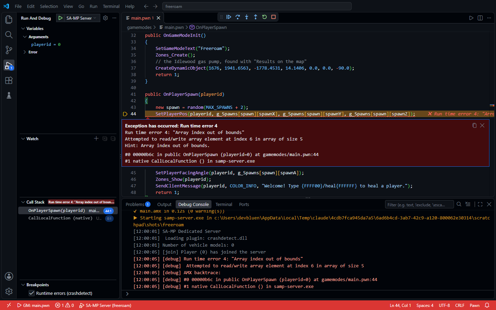

**F6**, o botão ▶ da aba *Servidor* ou Executar e Depurar → *Servidor SA-MP / open.mp*:

1. compila o gamemode (e para se houver erro);
2. avisa se o `server.cfg` carrega outro gamemode;
3. inicia o `samp-server.exe` / `omp-server.exe` e mostra o log ao vivo no **Console de Depuração**;
4. quando o **crashdetect** acusa um erro (índice fora do array, função nativa falhou, travamento…):
   - o VS Code **para na linha exata** com a mensagem do erro e uma dica;
   - a **pilha de chamadas** mostra cada função com arquivo e linha;
   - a aba **Variáveis** mostra os argumentos de cada função (`playerid = 0`, `cmdtext = "/teste"`);
   - o servidor continua rodando: **Continuar (F5)** segue em frente;
5. o **REPL** do Console de Depuração manda comandos ao servidor: via RCON no SA-MP (precisa de
   `rcon_password`), pelo console no open.mp.

> O SA-MP não permite breakpoints nem execução passo a passo. O depurador mostra **onde** e
> **por que** o erro aconteceu. Instale o crashdetect (busque "crashdetect" em Pacotes) e mantenha
> `-d3` nos argumentos do compilador.

## Barra lateral "Pawn"

- **Compilação:**
  - resultado da última compilação ou verificação, com tempo e horário;
  - alvo e tamanho do `.amx`;
  - erros e avisos clicáveis;
  - compilador e pastas de include.
- **Pacotes:** dependências diretas e indiretas, com o estado de cada uma (instalado, atualizado,
  atualização disponível, faltando), plugins e include paths; ações inline.
- **Servidor:**
  - rodando ou parado;
  - executável (SA-MP ou open.mp), `server.cfg`, gamemode e porta;
  - log do servidor;
  - plugins, avisando quando um arquivo está faltando em `plugins/`;
  - histórico de **erros em execução** com a pilha de chamadas clicável.

## Configurações

| Configuração | Padrão | Descrição |
|---|---|---|
| `pawnStudio.language` | `auto` | idioma da extensão (`auto`, `en`, `pt-br`) |
| `pawnStudio.compilerPath` | `""` | caminho do `pawncc` (vazio = automático) |
| `pawnStudio.includePaths` | `[]` | pastas extras de include |
| `pawnStudio.args` | `["-;+", "-(+", "-d3"]` | argumentos do compilador |
| `pawnStudio.outputDirectory` | `""` | pasta do `.amx` |
| `pawnStudio.entry` | `""` | alvo fixo |
| `pawnStudio.saveBeforeCompile` | `true` | salvar antes de compilar |
| `pawnStudio.lint.quick` | `true` | análise rápida enquanto digita |
| `pawnStudio.lint.onType` | `true` | `pawncc` em segundo plano sem salvar |
| `pawnStudio.lint.delay` | `1500` | ms parado antes de chamar o `pawncc` |
| `pawnStudio.lintOnSave` | `true` | verificação em segundo plano ao salvar |
| `pawnStudio.completion.parameters` | `required` | parâmetros inseridos pelo autocompletar |
| `pawnStudio.revealOutput` | `onError` | quando mostrar a saída |
| `pawnStudio.errorLens.*` | — | error lens (ativar, avisos, outras linguagens) |
| `pawnStudio.server.path` | `""` | `samp-server.exe` / `omp-server.exe` |
| `pawnStudio.packages.checkUpdatesOnStartup` | `true` | verificar atualizações ao abrir |
| `pawnStudio.gtaPath` | `""` | pasta do GTA San Andreas para as ferramentas (vazio = automático) |
| `pawnStudio.dialogs.codeStyle` | `auto` | código do Dialog Creator: `auto`, `native`, `easy` |

## Desenvolvimento

```
npm install
npm test            # testes unitários + gramática + traduções
npm run test:live   # integração real com o GitHub (instala crashdetect + streamer numa pasta temporária)
npm run test:vscode -- <pawncc.exe> <pasta-include>...   # abre um VS Code real e testa tudo
npm run package     # gera o .vsix
```

### Traduções

- As mensagens do código usam `t('English text {0}', valor)` (`src/i18n.ts`). As traduções ficam em
  `l10n/bundle.l10n.<idioma>.json`.
- Menus e configurações usam `package.nls.json` / `package.nls.<idioma>.json`.
- O `npm test` falha se alguma mensagem ficar sem tradução ou com placeholders diferentes.
- Para adicionar um idioma, copie os arquivos `pt-br`, traduza e inclua o idioma na configuração
  `pawnStudio.language`.
